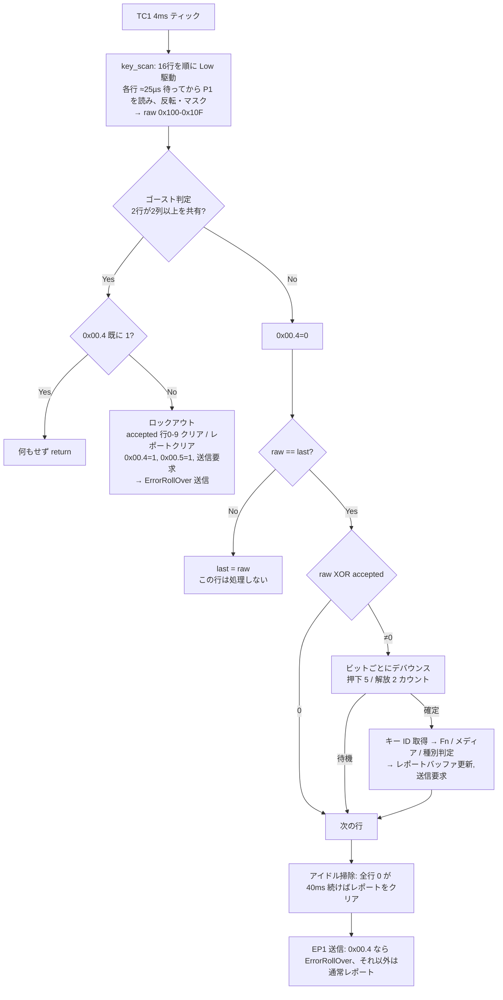

# KU-1255 キースキャン処理フロー

KU-1255 (SN8F2288) のファームウェアが、キーマトリクスを読み取ってから USB キーボードレポートを送信するまでの処理を、逆アセンブル結果から追ったもの。

- 解析対象: `firmware/fw_mod.asm`（行番号はコミット `33ad4bd` 時点）
  - `fw_mod.asm` 内の Key ID Map は開発用のサンプル配列を含むため、キーコードの値そのものは既定ファームウェアと異なる箇所がある。処理の流れは同一。
- 電気特性: SONiX SN8F2280 Series Datasheet V1.6（§1.4 Pin Descriptions, §8.4 TC1, §17.2 Electrical Characteristic）
- キーマトリクス: [`keymatrix.csv`](keymatrix.csv)

---

## 1. ハードウェア構成

### 1.1 ポートの役割

| 役割 | ピン | I/O 電源 | 内蔵プルアップ (Vdd=5V) | 入力閾値 |
|---|---|---|---|---|
| 列（読み取り）| P1.0–P1.7 | VDD (USB 5V, 実測 ≈4.78V) | Rup1: 25 / **40** / 70 kΩ | ViL1 ≤ 0.2·Vdd, ViH1 ≥ 0.8·Vdd |
| 行（駆動）| P0.3–P0.6, P4.0–P4.7 | VDD | Rup1: 25 / **40** / 70 kΩ | — |
| 行（駆動）| P2.0–P2.3 | **VREG33 (3.3V)** | Rup2: 30 / **55** / 100 kΩ | ViL2 ≤ 0.2·VREG33, ViH2 ≥ 0.8·VREG33 |
| TrackPoint I2C | P2.4 (SCL), P2.5 (SDA) | VREG33 | — | — |

- すべての入力は Schmitt トリガ構造（P4 を除く）。
- P2 は VREG33 系で、入力許容範囲は −0.3V〜VREG33+0.3V。5V 系への外付けプルアップは不可。
- マトリクスにダイオードは無い（ゴーストが発生しうる）。

### 1.2 初期化 (`fw_mod.asm:197-229`)

```
P0M  = 0x00, P0UR = 0xFF   ; P0 全入力・全プルアップ
P1M  = 0x00, P1UR = 0xFF   ; P1 全入力・全プルアップ, P1W = 0xFF（ウェイクアップ有効）
P2M  = 0x80, P2UR = 0x0F   ; P2.7 のみ出力, P2.0–P2.3 プルアップ
P2   = 0x70
P4M  = 0x00, P4UR = 0xFF   ; P4 全入力・全プルアップ
P5M  = 0x3F, P5 = 0x0F     ; P5.0–P5.5 出力
```

待機中の行はすべて **入力＋プルアップ**（Hi-Z ではない）。そのため待機中の電位は以下のとおり。

| ノード | 待機電位 |
|---|---|
| 列 P1.x | ≈4.78V |
| 行 P0.x / P4.x | ≈4.78V |
| 行 P2.0–P2.3 | ≈3.3V |

→ **P2 行と列の交点には、待機中でも常に約1.5V の直流電位差がかかっている。**

---

## 2. タイミングとメインループ

### 2.1 4ms ティック（TC1）

`func_0152` (`fw_mod.asm:380`) で TC1 を設定する。

| 設定 | 値 | 意味 |
|---|---|---|
| Fcpu | 12MHz / 4 = 3MHz | コードオプション `Fcpu = Fosc/4` |
| TC1M | 0x24 | TC1rate=010 → Fcpu/64 = 46.875kHz, ALOAD1=1（自動リロード）|
| TC1C / TC1R | 0x44 | 256 − 68 = 188 カウントでオーバーフロー |

→ 周期 ≈ **4.01 ms**。TC1 割り込み (`fw_mod.asm:57`) は `0x59.7` をセットするだけ。

### 2.2 メインループ (`_reset_00e8`, `fw_mod.asm:247`)

```
loop:
  WDT クリア
  if SUSPEND: func_0a02（サスペンド処理）
  wait until 0x59.7 == 1      ; 4ms ティック待ち
  0x59.7 = 0, 0x02++
  func_09ae                    ; TrackPoint 初期化シーケンス
  [条件付き] func_06ba         ; TrackPoint 読み取り（P2.6 = TP データ準備）
  key_scan                     ; ★ マトリクス読み取り〜キー処理（本書の主題）
  func_015e                    ; 設定のフラッシュ書き込み（要求時のみ）
  アイドル掃除（§7）
  if EP1 空き: func_1098        ; キーボードレポート送信
  if EP2 空き: func_12a4        ; マウス/コンシューマレポート送信
  goto loop
```

**キースキャンは 4ms に1回**。1回のスキャンで全16行を読み、そのまま判定処理まで行う。

---

## 3. マトリクス読み取り (`key_scan`, `fw_mod.asm:1210`)

### 3.1 行ごとの手順

各行に対して次を繰り返す。

```
B0BSET  PxM.n      ; 行ピンを出力に
B0BCLR  Px.n       ; 出力 Low（スキャン開始）
CALL    read_row
B0BSET  Px.n       ; 出力ラッチを High に戻す
B0BCLR  PxM.n      ; 入力（＋プルアップ）に戻す
```

`read_row` (`fw_mod.asm:1193`):

```
MOVC                 ; ROM[0x0100 + Z] から当該行の列マスクを読む（Z=0x86 から開始 → ROM 0x0186〜0x0195）
0x07 = mask
func_0140(0x0E)      ; 待ち時間（下記）
A = P1               ; 列を読む
A = (A XOR 0xFF) AND mask   ; アクティブ Low → 押下=1 に反転してマスク
RAM[0x0100 + row] = A       ; 生データバッファ
```

- Z レジスタは「ROM マスク表のオフセット (0x86〜)」と「RAM 生データのオフセット (0x00〜)」を `ADD Z,#0x7A` / `ADD Z,#0x87` で交互に切り替えて使っている。
- **待ち時間**: `func_0140(14)` は 1 ループ ≈5 サイクル × 14 ≈ 70 サイクル + 呼び出しオーバーヘッド ≈ **25 µs**。
  - 行を Low にしてから P1 を読むまで ≈27 µs、行が Low の時間は ≈31 µs。
  - 16 行のスキャン全体は ≈0.5 ms。
  - 各行が Low になるのは 4ms 周期の **約 0.8%** の時間だけ。テスターで測る平均電圧には、スキャンの影響はほとんど現れない。

### 3.2 スキャン順と行マスク

行インデックス（RAM オフセット）はスキャン順で決まる。マスクは `fw_mod.asm:445-460`。

| idx | 行ピン | 電源 | マスク | bit0 (P1.0) … bit7 (P1.7) |
|---|---|---|---|---|
| 0 | **P2.2** | 3.3V | 0xFF | Esc, `, Q, 1, A, Z, Int5, **Tab** |
| 1 | P2.0 | 3.3V | 0xBF | F4, F2, E, 3, D, C, –, F3 |
| 2 | P4.0 | 5V | 0xBE | ~~NUBS~~, F1, W, 2, S, X, –, CapsLock |
| 3 | P4.5 | 5V | 0x22 | –, LCtrl, –, –, –, RCtrl, –, – |
| 4 | P4.1 | 5V | 0xFF | G, 5, R, 4, F, V, B, T |
| 5 | P2.1 | 3.3V | 0xFF | H, 6, U, 7, J, M, N, Y |
| 6 | P4.4 | 5V | 0xFF | F6, =, I, 8, K, `,`, Int1, ] |
| 7 | P4.2 | 5V | 0xFF | Int4, F8, O, 9, L, `.`, Int2, F7 |
| 8 | P4.3 | 5V | 0xFF | ', -, P, 0, ;, NUHS, /, [ |
| 9 | P2.3 | 3.3V | 0xA0 | –, –, –, –, –, RShift, –, LShift |
| 10 | P0.5 | 5V | 0xEF | F5, F9, Int3, F10, ~~\\~~, Return, Space, BS |
| 11 | P0.4 | 5V | 0x4A | –, Home, –, F11, –, –, Down, – |
| 12 | P4.6 | 5V | 0x41 | LAlt, ~~KP_MS~~, –, –, –, –, RAlt, – |
| 13 | P4.7 | 5V | 0xC8 | –, –, ~~KP_MC~~, F12, –, –, Right, LGUI |
| 14 | P0.3 | 5V | 0x59 | Up, –, –, End, Fn, ~~Pause~~, Left, ~~KP_MR~~ |
| 15 | P0.6 | 5V | 0x7A | –, Delete, –, Insert, PrtSc, PgUp, PgDn, – |

（キー名は [`keymatrix.csv`](keymatrix.csv) から。~~取り消し線~~はマトリクス上は定義されているが、マスクで 0 になっている（読まれない）ビット。マスクで 0 のビットは読み取り直後に捨てられるため、以降のゴースト判定・変化判定のどちらにも現れない。例えば **NONUSBACKSLASH (P4.0×P1.0) は、JISマスクでは常に無視される**。）

---

## 4. ゴースト判定とロックアウト (`func_0186_00b4`, `fw_mod.asm:1295`)

### 4.1 判定アルゴリズム

生データ `RAM[0x100..0x10F]` を、**デバウンスを経ずにそのまま**検査する。

```
for i in 0..14:
    if popcount(raw[i]) >= 2:
        for j in i+1..15:
            if popcount(raw[i] AND raw[j]) >= 2:
                goto LOCKOUT
0x00.4 = 0              ; ゴースト無し → ロックアウト解除
goto CHANGE_DETECTION   ; §5
```

「2つの行が2本以上の列を共有する（矩形の4隅がそろう）」状態をゴースト候補とみなしている。3隅だけの場合（本物のゴースト位置は不明）は検出できない。

> **元ファームウェア (Lenovo) とは判定条件が異なる。** 元ファームウェアは「2行の生データが**完全に一致**し、かつ2ビット以上」の場合だけをゴーストとし、さらに特定の3パターンを例外として除外する。改変版の判定は元より広く、ロックアウトが起きやすい。詳細は §12。

### 4.2 ロックアウト時の処理 (`func_0186_010a`, `fw_mod.asm:1348`)

```
if 0x00.4 == 1: return            ; すでにロックアウト中なら何もせず終了
0x00.4 = 1                        ; ロックアウト（= ErrorRollOver 状態）
0x13.0 = 1                        ; レポート送信要求
0x00.2 = 1
clear RAM[0x120..0x129]           ; ★ 確定状態バッファの「行0〜9」のみクリア
0x15 = 0                          ; モディファイア
clear RAM[0x17..0x20]             ; レポートのキースロット
0x00.5 = 1                        ; 再同期要求
return
```

注意点:

1. **確定状態のクリアは行 0〜9 だけ**。行 10〜15（P0.5, P0.4, P4.6, P4.7, P0.3, P0.6）は確定状態が残る。
2. **キー数 `0x10` はクリアされない**。
3. ロックアウトが続いている間は、毎スキャン「ゴースト検出 → 即 return」となる。生データ以外のバッファ（0x110, 0x120）は一切更新されない。
4. ロックアウト中に送られるレポートは ErrorRollOver（§8）。

### 4.3 ロックアウト解除後

ゴースト条件が消えたスキャンで `0x00.4 = 0` になり、§5 の通常処理が再開する。ただし、この時点ではレポート送信要求（0x13.0）は立たない。

- 行 0〜9 で押され続けているキー: 確定状態が 0 にクリアされているので、新たな押下として検出される → デバウンス後に再びレポートに載る。
- 行 10〜15 で押され続けているキー: 確定状態は 1 のまま、レポートからは消えている → **離されるまでホストに報告されない**（隠れ押下）。
- 何も押されていない場合: §7 のアイドル掃除で、約 40ms 後に空レポートが送られる。

---

## 5. 変化検出とデバウンス (`func_0186_0120`, `fw_mod.asm:1374`)

行ごと（idx 0→15）に以下を行う。3つのバッファを使う。

| RAM | 名前 | 内容 |
|---|---|---|
| 0x100–0x10F | 生データ (raw) | 今回スキャンの読み取り値（マスク後）|
| 0x110–0x11F | 前回生データ (last) | 前回スキャンの読み取り値 |
| 0x120–0x12F | 確定状態 (accepted) | デバウンス済みの押下状態 |

### 5.1 第1段: 2スキャン一致

```
if raw[row] != 0: 0x00.2 = 1, 0x44 = 10   ; アイドル掃除カウンタをリロード（§7）
if raw[row] != last[row]:
    last[row] = raw[row]                  ; 変化した直後のスキャンは処理しない
    next row
diff = raw[row] XOR accepted[row]         ; 2回連続で同じ値のときだけ確定状態と比較
if diff == 0: next row
```

### 5.2 第2段: キーごとのカウンタ (`func_0186_0146` のビットループ)

`diff` の各ビット（bit0→bit7）について:

1. 押下か解放かを判定する（`0x00.3 = 1` なら解放）。
2. キー ID を取得する: `ROM[0x0196 + row*8 + bit + 1]`。下位バイトが通常レイヤ、上位バイトが第2レイヤ（`0x00.7` が立っているとき）。
3. デバウンス表を参照する。

| 種類 | 関数 | スロット | カウンタ | 初期値 | 待機中の扱い |
|---|---|---|---|---|---|
| 押下 | `func_04fd` (`:1991`) | 0x144–0x14D (10個) | 0x14E–0x157 | **5** | 0x0c のビットを 0 に戻す（未確定）|
| 解放 | `func_054f` (`:2087`) | 0x130–0x139 (10個) | 0x13A–0x143 | **2** | 0x0c のビットを 1 に戻す（未確定）|

- 初めて検出されたキー: 空きスロットに登録し、カウンタを初期値にして「待機」とする。
- 登録済みのキー: カウンタを 1 減らし、0 になったらスロットを解放して「確定」とする（FC=0 で次の処理へ）。
- P5.4 / P5.5 は、スロットの登録時に 1、確定時に 0 になる（用途は不明）。
- 空きスロットが無い場合は、デバウンスなしで即確定となる。

ビットループ後、`0x0c`（未確定ビットを戻した値）を `accepted[row]` に書き込む。

### 5.3 遅延

| イベント | 最初に生データが変わってから確定まで |
|---|---|
| 押下 | 6 スキャン ≈ **24 ms** |
| 解放 | 3 スキャン ≈ **12 ms** |

### 5.4 注意点

- 待機中にキーが元の状態へ戻ると diff が 0 になり、そのスロットは二度と参照されずに残る（カウンタ途中の古いスロット）。同じキーが同じ向きに再び変化すると、残りのカウンタから続行するため早く確定する。
- 生データが毎スキャン変動する（閾値付近でちらつく）キーは第1段を通過しないため、押下にも解放にもならない。一方、§4 のゴースト判定は生データを直接見るので、**1回だけのちらつきでもロックアウトは発生する**。

---

## 6. 確定後のキー処理

### 6.1 Fn 関連 (`func_0186_015f`, `fw_mod.asm:1456`)

- キー ID 0xAF が Fn。Fn 押下フラグは `0x00.0`。
- Fn+B → Break、Fn+S → SysRq、Fn+Esc → FnLock 切り替え。
- `0x74` と `0x00.0 / 0x00.1`（Fn 押下 / FnLock）の組み合わせで、F1〜F12 をメディアキー（`f1_mute` 〜 `f12_process`）として扱うかを決める。

### 6.2 種別判定 (`key_categorization`, `fw_mod.asm:1720`)

| キー ID | 種別 | 処理 |
|---|---|---|
| < 0xCD | 通常キー | `func_0489`（押下）/ `func_04ab`（解放）|
| 0xCD–0xD4 | 特殊ファンクション | `function_key` テーブル |
| 0xD5–0xDF | アプリケーション（コンシューマ）| `application_key` |
| 0xE0–0xE7 | モディファイア | 0x15 のビット操作（0xE7 は第2レイヤキー → `0x00.7`）|
| ≥ 0xE8 | マクロ | ROM 表からキー ID とモディファイアを読む |

### 6.3 レポートバッファ

| RAM | 内容 |
|---|---|
| 0x10 | 登録キー数 |
| 0x15 | モディファイアバイト |
| 0x17–0x20 | キースロット（10個）|

- `func_0489`（押下）: 先頭から空きスロットを探して登録する。キー数が 6 を超えると `0x00.4 = 1`（ロールオーバー）。
- `func_04ab`（解放）: 該当スロットを削除し、後ろのスロットを詰める。キー数が 6 以下になれば `0x00.4 = 0`。
- どちらも `0x13.0 = 1`（送信要求）を立てる。

`0x00.4` は **ゴーストロックアウトと 6キー超過の両方で共有**されているフラグである。

---

## 7. アイドル掃除（メインループ, `fw_mod.asm:265-293`）

`key_scan` の後に毎ティック実行する。

```
if 0x00.2 == 0:
    0x44 -= 1
    if 0x44 == 0:                       ; 生データが全行 0 の状態が 10 ティック（≈40ms）続いた
        0x44 = 10
        if 0x10 != 0:              clear report → 送信     (func_0129)
        elif 0x15 != 0 or 0x17 != 0: clear report → 送信   (func_0133)
        elif 0x00.5 == 1:          0x00.5 = 0, clear report → 送信
```

- `0x44` は、どれか1行でも生データが非 0 のスキャンがあると 10 にリロードされる（§5.1）。
- つまり **マトリクスが完全に空の状態が約 40ms 続けば、レポートの不整合（取り残されたキー）は掃除される**。逆に、どこかの交点が常に読まれ続けている限り、この掃除は走らない。

---

## 8. USB レポート送信 (`func_1098`, `fw_mod.asm:4869`)

- `0x13.0 == 1` のときだけ EP1 にキーボードレポート（8バイト）を書き込み、送信後に `0x13.0 = 0` とする。
- `0x00.4 == 1` のときは ErrorRollOver レポートを送る (`func_1098_004a`, `fw_mod.asm:4952`)。

```
modifier=0x00, reserved=0x00, keys=[0x01, 0x01, 0x01, 0x01, 0x01, 0x01]
```

- HID 仕様上、ErrorRollOver は「この報告は無効」を意味する。少なくとも Linux の hid-input は、このレポートを無視して **直前のキー状態を保持する**（押されていたキーは押されたまま、OS 側のオートリピートも続く）。

---

## 9. 全体フロー



---

## 10. RAM マップ（スキャン関連）

| アドレス | 用途 |
|---|---|
| 0x00.0 | Fn 押下中 |
| 0x00.1 | FnLock |
| 0x00.2 | 行データ非 0（アイドル掃除の抑止）|
| 0x00.3 | 処理中ビットが解放（1）/ 押下（0）|
| 0x00.4 | ロックアウト / 6キー超過 → ErrorRollOver |
| 0x00.5 | 再同期要求（アイドル掃除でレポートをクリア）|
| 0x00.7 | 第2レイヤキー押下中 |
| 0x07 / 0x08 | 行インデックス（ゴースト判定時は i / j）|
| 0x09 / 0x0a / 0x0b / 0x0c | 作業用: 現在行 / 比較値 / diff / 書き戻し値 |
| 0x0d / 0x0e | ビットカウンタ (1–8) / 行オフセット (row*8) |
| 0x0f | 処理中のキー ID |
| 0x10 | レポートのキー数 |
| 0x13.0 | キーボードレポート送信要求 |
| 0x15 | モディファイアバイト |
| 0x17–0x20 | レポートキースロット |
| 0x44 | アイドル掃除カウンタ（10 ティック）|
| 0x59.7 | 4ms ティックフラグ |
| 0x100–0x10F | 生データ |
| 0x110–0x11F | 前回生データ |
| 0x120–0x12F | 確定状態 |
| 0x130–0x143 | 解放デバウンス（スロット / カウンタ）|
| 0x144–0x157 | 押下デバウンス（スロット / カウンタ）|

---

## 11. 接触不良の診断で特に重要な挙動

1. **ゴースト判定はデバウンスされていない**。閾値付近の交点が1スキャンだけ読まれても、ロックアウトが発生する。
2. **ロックアウト中は ErrorRollOver が送られ、ホストは直前の状態を保持する**。ロックアウト直前に押下として報告されていたキーは、ホスト上では押されたまま（オートリピート継続）に見える。この状態は、次に通常レポートが送られるまで続く。
3. 通常レポートが再び送られるのは、次のどちらかの場合だけ。
   - いずれかのキー変化が確定したとき
   - マトリクスが完全に空の状態が約 40ms 続いたとき
   
   どこかの交点が常に読まれ続け、かつ他のキー変化も起きない場合、ホスト上の押しっぱなしは解消しない。
4. ロックアウトは確定状態を **行 0〜9 だけ** クリアする。行 10〜15 のキーは、押されたままロックアウトをまたぐと「隠れ押下」になる。
5. 行マスク（ROM 0x0186–0x0195）で 0 にしたビットは、読み取り直後に捨てられる。ゴースト判定・変化検出・レポートのいずれにも影響しない。特定の交点を無効化する手段として使える。
6. P2 行（idx 0, 1, 5, 9）は 3.3V 系、それ以外の行と列は 5V 系である。押されたキーは、列を各行の待機電位（3.3V または 5V のプルアップ）に結ぶ。そのため同じ列のキーでも、どの行のキーかによって列の電位への影響が異なる。

---

## 12. 元ファームウェア (Lenovo, `fw_org.asm`) との差分

スキャン関連で確認できた差分は次のとおり。タイミング（TC1 = 4ms）、スキャン順、待ち時間（`func_0140(0x0E)`）、2段階デバウンス（押下 5 / 解放 2）、ロックアウト時のクリア範囲（行 0〜9）、ErrorRollOver 送信は同一。

| 項目 | 元ファームウェア | 改変版 (`fw_mod.asm`) |
|---|---|---|
| 行マスク | **無し**（P1 の 8 ビットをすべて採用）| ROM 0x0186–0x0195 の行マスクで AND |
| ゴースト判定 | `popcount(raw[i]) ≥ 2` かつ **`raw[j] == raw[i]`**（完全一致）| `popcount(raw[i] AND raw[j]) ≥ 2` |
| 例外（ロックアウトしない）| raw[9]=raw[13]=0xC0 → raw[9]&=0x80 / raw[13]=raw[9]=0x88 → raw[9]&=0x80 / raw[12]=raw[13]=0xC0 → raw[12]&=0x40 | 無し（`func_0186_00df` への分岐を `func_0186_010a` に置換）|

- 元ファームウェアで「完全一致」の2行が現れるのは、4隅がそろい、かつ両行にそれ以外のビットが無い場合に限られる。改変版は、他のキーが同じ行で同時に押されていても検出する。
- 元の例外 3 パターンは、行 9 (P2.3: Shift)、12 (P4.6: Alt)、13 (P4.7: F12/Right/LGUI) の組み合わせ。モディファイアの同時押しで生じる既知のパターンを、ロックアウト対象から外していると考えられる。
